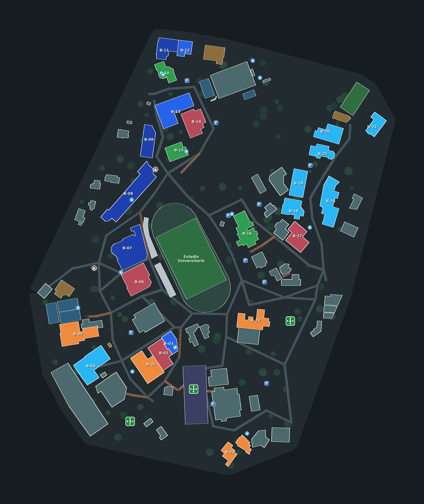

# Nav-ULEAM Campus: Estado Actual Técnico, Arquitectura y Código Fuente

> **Documento de Contexto Técnico para Desarrolladores y Modelos de IA**  
> **Estado del Repositorio:** Funcional, compilando al 100% (`BUILD SUCCESSFUL`), con pruebas unitarias verdes.  
> **Ramas Principales:** `main`, `contenido-grupo-4-5-6`, `feature/refactor-demo-grupo-6`.  
> **Última Actualización:** Noviembre 2026

---

## 1. Resumen Ejecutivo del Estado del Software

El proyecto se encuentra en un estado maduro y estable para la demostración en la Casa Abierta:
- **Compilación Limpia:** Compila sin errores ni advertencias bloqueantes tanto en `./gradlew test` (todas las pruebas unitarias pasadas) como en `./gradlew assembleDebug` (APK generado).
- **Deuda Técnica Eliminada:** Se erradicó por completo el motor antiguo `RoutingEngine.kt`, unificando toda la búsqueda de rutas óptimas y evacuación de emergencia (*Safe Zone*) en el motor `AStarEngine.kt`.
- **Compatibilidad de IDE:** Se corrigió el conflicto de módulos de Android Studio que causaba el error *"Compilation is not supported for the following modules: UleamNavigator"*, purgando carpetas duplicadas y reconfigurando `.idea/gradle.xml`.

---

## 2. Stack Tecnológico y Dependencias (`app/build.gradle.kts`)

| Componente | Versión / Detalle | Justificación Técnica |
| :--- | :--- | :--- |
| **Lenguaje** | **Kotlin 2.0.0** | Soporte oficial con el nuevo Compose Compiler integrado (`org.jetbrains.kotlin.plugin.compose`). |
| **Android SDK** | `minSdk = 26` (Android 8.0 Oreo)<br>`targetSdk = 34` (Android 14)<br>`compileSdk = 34` | `minSdk = 26` permite uso de APIs nativas modernas de Java Time y Location sin desugaring pesado. |
| **Build Tools** | **Gradle 8.7** + **AGP 8.5.0** | Compatible con JDK 17 (JBR 17.0.14 de Android Studio). |
| **UI Framework** | **Jetpack Compose BOM 2024.09.00** | Interfaz 100% declarativa y reactiva con Material 3. |
| **Librería de Íconos** | `androidx.compose.material:material-icons-extended` | Íconos vectoriales para direcciones (giros, escaleras, advertencias, GPS). |
| **Lifecycle & Flow** | `lifecycle-runtime-compose:2.8.6`<br>`lifecycle-viewmodel-compose:2.8.6` | Manejo seguro del ciclo de vida para recolectar flujos de ubicación sin fugas de memoria. |
| **Persistencia (BDD)** | **Room 2.6.1** (`room-runtime`, `room-ktx`) | Base de datos SQLite local para almacenamiento de nodos, aristas y lugares. Procesamiento de anotaciones vía KSP (`2.0.0-1.0.24`). |
| **Geolocalización** | `play-services-location:21.3.0` | API moderna de Google para `FusedLocationProviderClient` con optimización de consumo de batería. |
| **Testing** | **JUnit 5 (Jupiter 5.10.2)** | Pruebas unitarias de algoritmos con soporte para pruebas parametrizadas y contratos de datos. |

---

## 3. Estructura del Código y Responsabilidades por Módulo

Ruta base del código fuente:  
`app/src/main/java/ec/edu/uleam/navigator/`

```
ec.edu.uleam.navigator/
├── data/                      # Capa de persistencia Room y mappers de grafo
│   ├── Entities.kt            # Entidades Room: Nodo, Arista, Lugar
│   ├── CampusDao.kt           # Consultas SQL optimizadas y búsqueda sin tildes
│   ├── AppDatabase.kt         # Instancia Room Database + Singleton
│   ├── CsvSeeder.kt           # Carga automática de CSVs en primer arranque
│   ├── GraphMappers.kt        # Conversión de entidades Room a CampusGraph
│   └── CampusRepository.kt    # Repositorio unificado para la UI
│
├── location/                  # Abstracción de sensores, brújula, filtrado GNSS y hardware
│   ├── CompassSource.kt       # Sensor de orientación (TYPE_ROTATION_VECTOR) con filtro paso bajo
│   ├── LocationFilter.kt      # Filtro de incertidumbre (>30m) y saltos multipath (>20 m/s)
│   └── LocationSource.kt      # Interfaz reactiva, FusedLocationSource y FakeLocationSource
│
├── routing/astar/             # Motor algorítmico A* y navegación Turn-by-Turn
│   ├── GraphModels.kt         # Modelos de grafo: GraphNode, GraphEdge, RoutingResult
│   ├── GeoMath.kt             # Haversine, cálculo de rumbo (bearing), giros y distancia a segmento
│   ├── CampusGraph.kt         # Grafo inmutable validado en memoria
│   ├── AStarEngine.kt         # Algoritmo A*, Snap-to-node, isOffRoute y Dijkstra para Zona Segura
│   └── NavigationGuidance.kt  # Generador de instrucciones de texto paso a paso
│
└── ui/                        # Capa de presentación Jetpack Compose
    ├── CampusViewModel.kt     # Estado global de la pantalla (UiState) y orquestación
    ├── MainActivity.kt        # Actividad principal, permisos y tarjeta flotante colapsable
    └── map/
        ├── CampusMap.kt            # Canvas: capa base del campus, caminos, ruta, etiquetas, usuario y botones
        ├── CampusShapes.kt         # Carga y dibujo de la capa base (edificios, estadio, canchas, plaza, íconos),
        │                           # paleta MapTheme, etiquetas y PathVisibility (qué aristas se pintan)
        ├── MapProjection.kt        # Proyección WGS84 <-> Pantalla con zoom, paneo y rotación
        ├── RouteProgress.kt        # Progreso sobre la ruta, rumbo y hit-test de lugares
        ├── OriginPicker.kt         # Origen GPS: entrada del edificio donde está el usuario o mejor nodo cercano; llegada
        ├── MapStyle.kt             # Estilo del mapa (Claro / Oscuro / Sistema) y su preferencia guardada
        └── AnimatedUserPosition.kt # Desplazamiento suave del marcador del usuario
```

---

## 4. Detalle Técnico de los Componentes Clave

### 4.1. Base de Datos y Datos Cartográficos (`data/`)
- **Archivos de Origen (`app/src/main/assets/`):**
  - `nodos.csv`: 135 nodos con columnas `id, lat, lon, tipo` (`CALLE`, `DESTINO`, `ZONA_SEGURA`), `tiene_escaleras`, `etiqueta`.
  - `aristas.csv`: 185 conexiones peatonales con `id_origen, id_destino, distancia_metros, tiene_escaleras`.
  - `campus_shapes.csv`: capa base visual del mapa (solo diseño, no interviene en las rutas). Columnas `tipo, codigo, grupo, puntos` (lista `lat lon` separada por espacios). Tipos: `EDIFICIO` (bloques B-xx, `grupo` = sigla de facultad para el color), `OTRO` (edificios administrativos), `COMIDA`, `PISTA`, `CANCHA_ESTADIO`, `GRADA`, `CANCHA`, `CANCHA_VERDE`, `PLAZA`, y puntos `PARQUEO`, `AGUA`, `CAFE` y `ESCALERA` (escalera decorativa de 2 puntos). Se genera con `build_shapes_osm.py` a partir de `data/osm/osm_poligonos.geojson` (exportado de QGIS con QuickOSM: `building` / `highway` / `leisure`). Datos © OpenStreetMap contributors (ODbL); se incluyen en la app, por lo que el mapa sigue siendo 100% offline. `build_shapes.py` (trazado manual sobre fotos) queda obsoleto.
  - `lugares.csv`: Puntos de interés del campus con `id_nodo, codigo, nombre, descripcion, categoria, etiquetas, busqueda, activo`. Los bloques B-01..B-25 se buscan por **Facultad, sigla (FETAH, FCSDB, FCACC, FIIA, FACIVITEC, FCS), carreras y código de bloque**; `codigo` tiene la forma `SIGLA·B-xx`. Se genera con `build_lugares.py` a partir de `data/nodos_u.csv` (sin alterar `nodos.csv` ni `aristas.csv`). Como el CSV de QGIS no trae tildes, el script las restaura al mostrar (`nombre`, `descripcion`) con un diccionario de palabras (`ACENTOS`); `busqueda` queda siempre sin tildes. Para agregar una palabra nueva basta añadirla a `ACENTOS` y volver a ejecutar el script.
- **`CsvSeeder.kt`:** En la primera inicialización de Room inserta nodos, aristas y lugares. En arranques posteriores refresca solo la tabla `lugares` (`clearLugares()` + `insertLugares()`), de modo que las instalaciones existentes reciben el catálogo de facultades sin tocar el grafo.
- **`CampusDao.kt`:** Realiza consultas directas a SQLite. La búsqueda (`CampusRepository.filtrar`) normaliza a minúsculas, sin tildes ni puntuación, y exige que todos los términos aparezcan en `busqueda` ("facultad ciencias tecnologia", "facivitec", "odontologia", "b-16").
- **`GraphMappers.kt`:** Es el único puente desacoplador entre las tablas de Room y el motor algorítmico, convirtiendo `NodoEntity` y `AristaEntity` en las clases de datos puras `GraphNode` y `GraphEdge`.

### 4.2. Motor Algorítmico, Turn-by-Turn y Recálculo Dinámico (`routing/astar/`)
- **`AStarEngine.kt`:**
  - `findRoute(startNodeId, goalNodeId, avoidStairs)`: Ejecuta $A^*$ clásico utilizando una `PriorityQueue` ordenada por $f(n) = g(n) + h(n)$.
  - `findRouteFromLocation(location, goalNodeId, avoidStairs)`: Encuentra el nodo transitable de tipo `CALLE` más cercano dentro de un umbral de 100 metros (*snap-to-node*). Si el usuario está fuera de rango, retorna `RouteResult.Failure(OUTSIDE_CAMPUS)`.
  - `findNearestSafeZone(startNodeId, avoidStairs)`: Algoritmo de Dijkstra multidestino que calcula la distancia más corta hacia cualquier nodo clasificado como `ZONA_SEGURA`. Ignora nodos intermedios de tipo `DESTINO` para evitar atravesar interiores de edificios durante una evacuación.
  - `minDistanceToRoute(latitude, longitude, routeNodeIds)` e `isOffRoute(latitude, longitude, routeNodeIds, thresholdMeters = 15.0)`: Evalúan la desviación ortogonal mínima respecto a todos los segmentos de la polilínea activa para detectar desvíos reales.
- **`GeoMath.kt`:**
  - `haversine(lat1, lon1, lat2, lon2)`: Distancia en metros considerando el radio terrestre medio ($6,371,000 \text{ m}$).
  - `bearing(from, to)`: Rumbo azimutal en grados $[0^\circ, 360^\circ)$ entre dos puntos cartográficos.
  - `turnAngle(bearing1, bearing2)`: Diferencia angular relativa $[-180^\circ, 180^\circ]$ para inferir si el usuario debe continuar recto, girar a la derecha o girar a la izquierda.
  - `distanceToSegment(pointLat, pointLon, segStartLat, segStartLon, segEndLat, segEndLon)`: Distancia mínima ortogonal en metros proyectada sobre el plano tangente equirectangular local hacia un tramo de caminería.
- **`NavigationGuidance.kt`:**
  - Convierte la lista ordenada de nodos de una ruta en pasos legibles (`NavigationStep`):
    - `DEPART`: "Inicia tu recorrido en [Origen]".
    - `STRAIGHT`: "Avanza X metros recto".
    - `TURN_RIGHT`: "Gira a la derecha y avanza X metros".
    - `TURN_LEFT`: "Gira a la izquierda y avanza X metros".
    - `STAIRS`: "Usa las escaleras (precaución)".
    - `ARRIVE`: "Has llegado a [Destino]".
  - Incorpora compresión de segmentos rectos consecutivos para no saturar al usuario con indicaciones repetitivas.

### 4.3. Sensores, Brújula Peatonal, Filtrado GNSS, Ciclo de Vida y Batería (`location/`)
- **`CompassSource.kt`:**
  - `SensorManagerCompassSource`: Implementado con `callbackFlow` sobre `Sensor.TYPE_ROTATION_VECTOR` (y respaldo en `TYPE_ACCELEROMETER` + `TYPE_MAGNETIC_FIELD`).
  - Aplica un filtro circular paso bajo (`lowPassAzimuth`) interpolando por el arco angular más corto (`shortestAngleDelta`) para evitar saltos bruscos al cruzar el Norte ($359^\circ \leftrightarrow 0^\circ$), con umbral de emisión de $1.0^\circ$.
- **`LocationFilter.kt`:**
  - Evalúa cada muestra entrante (`GnssSample`) frente a la última posición válida aceptada (`lastAccepted`).
  - Descarta lecturas corruptas (`Invalid`), clasifica lecturas degradadas (`LowAccuracy` $> 30\text{ m}$) sin sobrescribir la posición válida previa, y rechaza saltos cinemáticos irreales (`RejectedJump` $> 20\text{ m/s}$) producidos por rebote de señal entre edificios (*multipath*).
  - Provee `filterTrace(samples)` para limpieza de trazas ruidosas y `reset()` ante pérdida de satélites.
- **`LocationSource.kt`:**
  - Sealed Interface `LocationState`: Estados explícitos de ubicación (`ProviderDisabled`, `PermissionDenied`, `Searching`, `Fix(lat, lon, accuracyM)`, `LowAccuracy(lat, lon, accuracyM)`).
  - `FusedLocationSource`: Implementado con `callbackFlow` sobre `FusedLocationProviderClient` integrado con `LocationFilter` y lectura inmediata inicial mediante `client.lastLocation`.
  - **Reinicio en Caliente y Eficiencia Energética:** En `CampusViewModel`, tanto `locationState` (con `flatMapLatest` para recarga inmediata tras conceder permisos sin reiniciar la app) como `azimuthDeg` utilizan `SharingStarted.WhileSubscribed(5000)`, apagando el GPS y la brújula 5 segundos después de minimizar la aplicación.
  - **Recálculo Inteligente Fuera de Ruta (`CampusViewModel.kt`):** Durante la navegación con GPS real, la ruta se mantiene estable mientras el usuario camine dentro del corredor de 15 m. Si se desvía $>15\text{ m}$ por más de 3 segundos consecutivos (`OFF_ROUTE_CONFIRMATION_MS = 3_000L`), recalcula la ruta asíncronamente en `Dispatchers.Default` sin parpadeo de UI, y valida de inmediato si el usuario se encuentra fuera del campus ($>100\text{ m}$).
  - `FakeLocationSource`: Implementación para emuladores o entornos sin GPS real.

### 4.4. Renderizado Cartográfico en Compose (`ui/map/CampusMap.kt` y `MapProjection.kt`)
- **Canvas Paramétrico y Rotación Afín (`MapProjection.kt`):** Proyecta las coordenadas geográficas reales del campus (latitud aproximada $-0.953$, longitud $-80.747$) a coordenadas de pantalla $(X, Y)$ con soporte interactivo para zoom, paneo compensado y rotación con dos dedos o alineada con la brújula.
- **Capa base estilo OpenStreetMap (`CampusShapes.kt`):** terreno crema sobre fondo oscuro con vegetación decorativa; edificios con la huella real de OSM, sombra, borde blanco y color por facultad (FCS celeste, FIIA azul oscuro, FACIVITEC verde, FETAH naranja, FCACC azul, FCSDB vino; administrativos gris azulado); estadio con pista, gradas y cancha con líneas; canchas, Plaza Cultural Centenario, cafeterías en amarillo, íconos de parqueo (P), hidratación y cafetería (El bosque, Tasty Food 2). Solo se rotulan los bloques del catálogo (B-xx), el estadio, la plaza y las Tasty.
- **Caminos:** se dibujan sobre las aristas del grafo (trazadas en QGIS sobre OSM) como veredas blancas con borde gris; las escaleras, en terracota con peldaños y recortadas para no tapar el camino. `PathVisibility` decide qué se pinta (solo visual, A* usa todas las aristas): oculta los accesos finales a lugares (`DESTINO`/`ZONA_SEGURA`) y tramos marcados por el equipo, pinta como escalera tramos que prolongan escaleras reales y agrega escaleras decorativas (`ESCALERA`).
- **Estilo claro / oscuro (`MapStyle.kt` + `MapTheme`):** `MapTheme` es la paleta del mapa y `MapTheme.dark` es estado de Compose, así que el Canvas se redibuja al cambiarlo. En la primera ejecución un diálogo pregunta el estilo (modo claro, modo oscuro o usar la configuración del sistema) y se guarda en `SharedPreferences` (`map_prefs`). Un botón bajo la barra de Puertas alterna Claro → Oscuro → Sistema. Los edificios conservan su color por facultad en ambos modos.
- **Cámara limitada al campus:** zoom mínimo 1.0 y `clampPan` impide arrastrar el mapa fuera del área de edificios y nodos; descuenta lo que tapan la búsqueda (arriba) y la tarjeta (abajo) para que los edificios del borde (B-11, B-12, etc.) se vean completos. El fondo alrededor del campus usa un tono cercano al terreno.
- **Zonas seguras:** se dibujan como la señal verde de "Punto de encuentro" (cuadro verde con flechas hacia una persona).
- **Crédito OSM:** botón ⓘ en la esquina inferior izquierda que abre el diálogo "Créditos del mapa" (licencia ODbL).
- **Infraestructura Diferenciada por Colores Institucionales (modo sin capa base):**
  - `BLOQUE`: Azul pizarra (`0xFF2C3E50`)
  - `ADMINISTRATIVO`: Azul profundo (`0xFF1A365D`)
  - `COMIDA`: Naranja cálido (`0xFFD35400`)
  - `DEPORTE`: Verde bosque (`0xFF27AE60`)
  - `CULTURA`: Púrpura institucional (`0xFF8E44AD`)
  - `ZONA_SEGURA`: Verde esmeralda de seguridad (`0xFF2ECC71`)
  - `ENTRADA / PUERTA`: Rojo ladrillo (`0xFFC0392B`)
- **Etiquetas de Texto Nativas:** Utiliza `android.graphics.Paint` para dibujar nombres de edificios con fondo tipo píldora de alto contraste, garantizando legibilidad en pantalla exterior.
- **Pulsing Blue Dot y Cono de Visión (FOV 45°):** Marcador del usuario con animación infinita (`rememberInfiniteTransition`), halo de incertidumbre GNSS en metros y **cono de visión azimutal translúcido de 45°** que rota en tiempo real con la orientación física del teléfono.
- **Botones Flotantes de Brújula/Norte y Recentrado:** Botones FAB para restablecer el Norte / alinear con la vista de la brújula y recentrar la cámara sobre la posición actual del usuario.

### 4.5. Interfaz de Usuario y Flujo de Permisos (`ui/MainActivity.kt`)
- **Manejo Resiliente de Permisos:** Utiliza `ActivityResultContracts.RequestMultiplePermissions` solicitando `ACCESS_FINE_LOCATION` y `ACCESS_COARSE_LOCATION` con activación inmediata en caliente (`vm.refreshLocationPermissionState()`).
  - Si el usuario deniega el permiso, se despliega un banner informativo con botón de reintento.
  - Si marca "No volver a preguntar", el botón redirige al usuario a la pantalla de configuración del sistema operativo (`Settings.ACTION_APPLICATION_DETAILS_SETTINGS`).
- **Tarjeta Flotante Colapsable (`CollapsibleNavigationCard`):**
  - Métricas en tiempo real: Distancia total en metros y tiempo estimado de caminata en minutos.
  - Conmutador **"Modo Simulación (Demo)"**: Permite seleccionar el origen tocando directamente sobre cualquier punto del mapa o eligiendo una puerta, garantizando que la aplicación funcione en interiores o carpas cerradas durante la Casa Abierta.
  - Conmutador **"Evitar Escaleras"**: Recalcula la ruta en caliente respetando accesibilidad física.
  - Botón de Emergencia **"Zona Segura"**: Botón rojo destacado que activa de inmediato la evacuación al punto seguro más próximo.
  - Lista Desplegable Paso a Paso: Visualización interactiva de cada instrucción del recorrido con íconos vectoriales específicos.

---

## 5. Resumen de las Últimas Acciones Realizadas en el Código

1. **Refactorización del Módulo de Dominio:** Se removió el viejo `RoutingEngine.kt` y se migró su lógica a `AStarEngine.kt` y `CampusRepository.kt`.
2. **Actualización de Configuración:** `minSdk = 26` en `app/build.gradle.kts` con dependencias de Play Services y Lifecycle Compose.
3. **Optimización de Sensores:** Creación de `LocationSource` desacoplado y blindaje del ciclo de vida en `CampusViewModel`.
4. **Enriquecimiento Visual:** Implementación del Canvas cartográfico en `CampusMap.kt` con etiquetas nativas legibles y *Pulsing Dot*.
5. **UI de Navegación Completa:** Tarjeta colapsable en `MainActivity.kt` con Turn-by-Turn, switch de simulación y diálogo de permisos.
6. **Resolución de Error de IDE:** Eliminación de metadatos Java no-Gradle residuales (`.idea/modules.xml`, `.idea/UleamNavigator.iml`) y saneamiento del árbol de Git.
7. **Recálculo Inteligente Fuera de Ruta (`T3.1`):** Implementación de `GeoMath.distanceToSegment()`, `AStarEngine.isOffRoute()` ($>15\text{ m}$), confirmación temporal ($>3\text{ s}$) en `CampusViewModel`, validación inmediata de GPS fuera del campus al conmutar modo Demo y pruebas unitarias en `GeoMathTest` y `AStarEngineTest`.
8. **Filtro de Saltos GNSS Anómalos (`T4.2`):** Creación de `LocationFilter.kt` (descarte de saltos $>20\text{ m/s}$ y lecturas de baja precisión $>30\text{ m}$), integración en `FusedLocationSource` y suite de pruebas con trazas ruidosas en `LocationFilterTest.kt`.
9. **Brújula Peatonal, Cono de Visión y Rotación de Mapa (`T4.1` + `T5.1`):** Creación de `CompassSource.kt` con filtro circular paso bajo, `MapProjection.kt` con rotación afín, renderizado del cono de visión de 45° y botón de brújula en `CampusMap.kt`, recarga en caliente de permisos GPS y pruebas unitarias en `CompassSourceTest.kt` (51 pruebas unitarias en verde).
10. **Búsqueda por Facultades/Carreras:** `lugares.csv` enriquecido (30 lugares con facultad/carreras), recarga segura del catálogo en `CsvSeeder`, normalización de puntuación en `CampusRepository`, subtítulo con bloque y carreras en los resultados y etiquetas del mapa `SIGLA·B-xx` (con primera carrera a zoom ≥ 2.8). Pruebas nuevas en `RealCampusDataTest`.
11. **Zoom anclado, "Mi ubicación" y "Empezar ruta":** el pellizco hace zoom sobre el punto bajo los dedos (`MapProjection.panForZoomAt`); botón extendido "Mi ubicación" cuando el usuario queda fuera de pantalla (y los botones flotantes ya no quedan tapados por la tarjeta inferior); botón "Empezar ruta" en la tarjeta de destino que activa el modo navegación (`CampusViewModel.empezarRuta/terminarRuta`): la cámara sigue al usuario, el marcador se desliza entre lecturas (`AnimatedUserPosition.kt`), el tramo recorrido se atenúa y se muestran los metros restantes (`RouteProgress.kt`). Durante la navegación el mapa gira suavemente para dejar el rumbo del usuario hacia arriba (GPS real: brújula, con el rumbo del tramo como respaldo; simulación: rumbo del tramo); se desactiva si el usuario gira el mapa a mano o toca la brújula. En Modo Simulación un caminante virtual recorre la ruta a 1,4 m/s (paso humano); en GPS real se detecta la llegada a ≤ 15 m del destino. Pruebas en `MapMathTest`.
12. **Elegir destino tocando el mapa:** un toque sobre un lugar (radio de 28 dp, `PlaceHitTest`) lo selecciona como destino, traza la ruta de vista previa y la tarjeta inferior muestra sus carreras y el botón "Empezar ruta". Un toque en espacio vacío conserva el comportamiento anterior (fijar origen en Modo Simulación) y mantener pulsado fija el origen aunque haya un lugar debajo. Los toques se ignoran mientras se navega.
13. **Ajustes de búsqueda y catálogo:** la tarjeta de búsqueda se oculta mientras se navega y reaparece al terminar o llegar; el teclado se cierra al elegir un destino; placeholder "Buscar Bloque, Facultad, Carrera, Otros…"; Tasty Food 1 figura con sus dos entradas (nodos 305 y 318) y El bosque pasa a categoría COMIDA (cafetería).
14. **Mapa del campus con datos de OpenStreetMap:** capa base vectorial (`campus_shapes.csv` + `CampusShapes.kt`) generada desde QGIS/QuickOSM con `build_shapes_osm.py`: edificios con dimensiones reales y color por facultad, estadio, canchas, Plaza Cultural, CIEC, Vicerrectorado y Agromarket como edificios, íconos de parqueo, agua y cafetería. Caminos dibujados sobre las aristas con estilo de vereda y escaleras con peldaños; tramos sobrantes ocultos y escaleras ajustadas según capturas del equipo. Crédito OSM en un botón ⓘ.
15. **Catálogo B-20 / B-21:** el B-20 (nodo 220) agrupa Psicología, Fisioterapia, Fonoaudiología, Terapia Ocupacional y Nutrición; el B-21 (nodo 221) figura como "No disponible por el momento" (`CARRERAS_DE` / `SIN_CARRERAS` en `build_lugares.py`).
16. **Interfaz:** barra de búsqueda más compacta (placeholder en una línea) y la barra de Puertas (P1–P4) también se oculta mientras se navega.
17. **Origen GPS realista (`OriginPicker.kt`):** si el GPS ubica al usuario dentro de la huella de un edificio, la ruta parte de una entrada de ese edificio (nodos DESTINO a ≤ 12 m del contorno), la que deja la ruta más corta; fuera de edificios se comparan los nodos de calle cercanos (hasta 30 m más lejos que el más cercano) y se elige el que minimiza caminar + ruta. Con GPS real se dibuja una línea punteada desde la posición del usuario hasta el inicio de la ruta. Elegir una puerta o un origen manual no se reemplaza por el GPS.
18. **Aviso de llegada:** al elegir un destino estando a ≤ 20 m de él (o dentro de su edificio) la tarjeta muestra "📍 Ya estás en tu destino" en lugar de la ruta; durante la navegación la llegada se detecta con el mismo criterio (`ARRIVAL_RADIUS_M = 20`).
19. **Fuera del campus:** con GPS real y el usuario a más de ~110 m del campus aparece "📍 No te encuentras en el campus ULEAM"; la cámara se queda en la universidad y "Mi ubicación" muestra el campus completo.
20. **Modo oscuro del mapa y cámara limitada:** ver la sección 4.4 (estilo Claro / Oscuro / Sistema, límite de desplazamiento y nuevo ícono de zonas seguras).
21. **Pruebas y Verificación:** 51 pruebas previas en verde; las nuevas pruebas (`RealCampusDataTest`, `MapMathTest`, `CampusShapesTest`, `OriginPickerTest`: salida por la entrada del edificio, llegada y fuera del campus; `MapStyleTest`: ciclo de estilos y modo sistema) deben ejecutarse con `./gradlew :app:testDebugUnitTest` en un entorno con Android SDK.

### Vista del mapa

| Modo claro | Modo oscuro |
|---|---|
|  |  |

*Vistas generadas a partir de `campus_shapes.csv`, `nodos.csv` y `aristas.csv` con la misma paleta de la app (sin la interfaz).*
